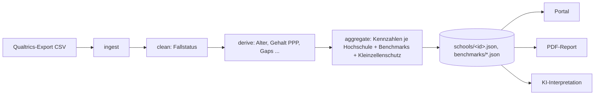
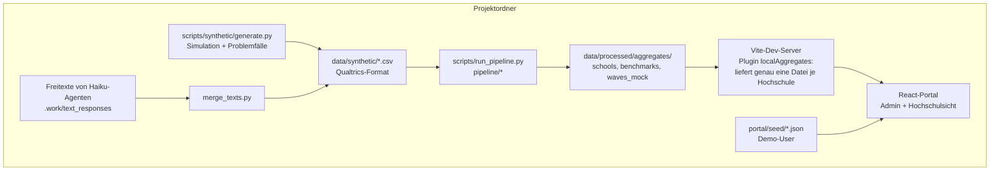
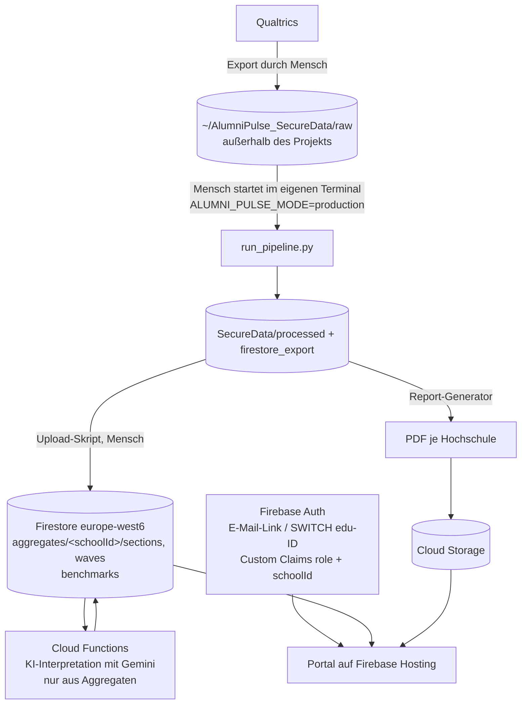

# Architektur: heute und künftig

## Leitidee

Eine einzige, getestete Pipeline verwandelt einen Qualtrics-Export in **ein JSON pro
Hochschule**. Diese Dokumente sind die einzige Schnittstelle zu allem, was danach kommt:
Portal, PDF-Report und KI-Interpretation. Einzelantworten verlassen die Pipeline nie.

## Heute (lokal, synthetische Daten)

| Baustein | Technik | Ort |
|---|---|---|
| Codebook | YAML, Loader mit Tests | `codebook/`, `pipeline/codebook.py` |
| Pipeline | Python 3.12, pandas | `pipeline/`, `scripts/run_pipeline.py` |
| Schwellen und Methodik | YAML | `config/settings.yaml` |
| Laufmodi und Datenschutz | `pipeline/environment.py` | synthetisch (Standard) oder Produktion |
| Portal | React 19, TypeScript, Vite, Vitest | `portal/` |
| Diagramme | D3.js (inkl. d3-sankey) | `portal/src/ui/school/*` |
| Auth und Daten im Portal | Ports `AuthService`/`DataService`, lokaler Adapter mit localStorage | `portal/src/services/` |
| Design | CSS-Tokens (Circle) | `portal/src/styles/tokens.css`, `docs/design/` |

**Mandantentrennung lokal:** Der Dev-Server gibt pro Anfrage genau eine Datei einer
Hochschule heraus. Der `DataService` prüft vorher Rolle, Accountstatus und `schoolId`, so
wie später die Firestore-Rules. Andere Hochschulen erscheinen nur als anonyme Werte
(`peers`), ohne Namen und ohne IDs.

## Künftig (Echtdaten, Firebase, PDF)

**Was sich beim Wechsel ändert und was nicht:**
- Die UI bleibt gleich. In `portal/src/services/index.ts` wird vom lokalen Adapter auf den
  Firebase-Adapter umgeschaltet (`VITE_BACKEND=firebase`).
- Die Pipeline bleibt gleich. Nur der Laufmodus wechselt auf Produktion, gestartet von einem
  Menschen. Claude Code ist dabei technisch ausgesperrt.
- Firestore erhält nur Aggregate, die die Mindestfallzahlen erfüllen. Datenmodell:
  `portal/docs/DATA_MODEL.md`, Migrationsschritte: `portal/docs/FIREBASE_MIGRATION.md`.
- **PDF-Reports** (noch offen): aus denselben Schul-JSONs mit denselben D3-Diagrammen
  gerendert, zum Beispiel per Headless-Browser (Playwright) aus einer Druckansicht des Portals.
  So sehen Portal und PDF garantiert gleich aus. Ablage in Cloud Storage, Metadaten in
  `reports/{schoolId}`.
- **KI-Interpretationen**: Im Prototyp schreibt Claude die Texte aus den synthetischen
  Aggregaten (`portal/insights/`). Später erzeugt eine Cloud Function mit Gemini die Texte,
  ausschließlich aus den aggregierten Fakten einer Hochschule. Ein Test prüft, dass jede
  Zahl im Text aus diesen Fakten stammt.
- **Längsschnitt**: pro Welle ein Dokument `aggregates/{schoolId}/waves/{year}`. Die
  Pipeline braucht dafür einen Wellen-Parameter. Das Format liefert heute
  `scripts/synthetic/mock_waves.py`.

## Datenschutz-Schichten

Siehe `docs/data_governance.md`: (1) Speicherort außerhalb des Projekts, (2) Deny-Regeln in
`.claude/settings.json`, (3) Guard-Hook `.claude/hooks/alumni_pulse_guard.sh` für alle
Tool-Aufrufe, (4) `pipeline/environment.py` verweigert den Produktionsmodus in Claude Code.
Dazu kommen Kleinzellenschutz und Mindestfallzahlen in der Pipeline (`pipeline/suppression.py`).
